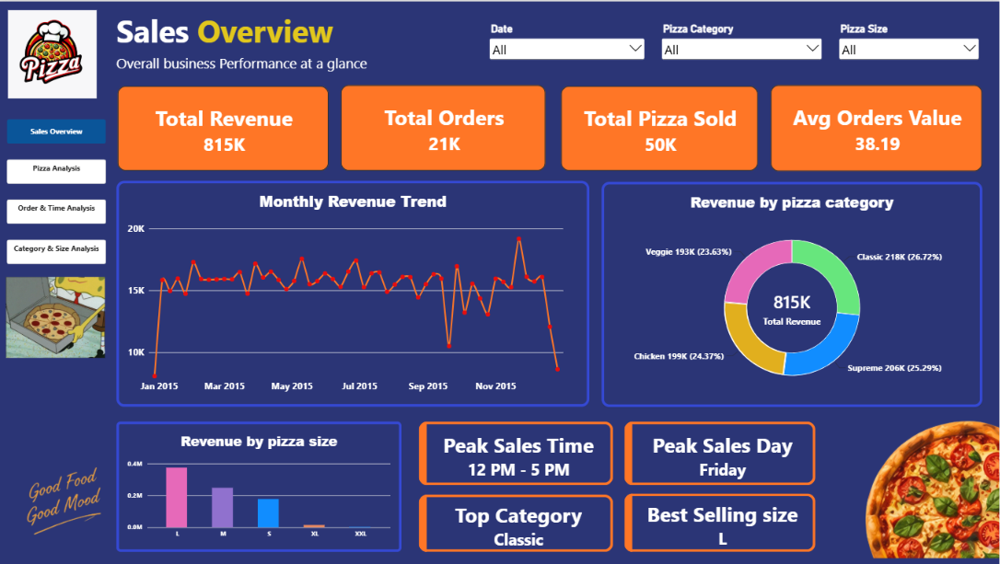
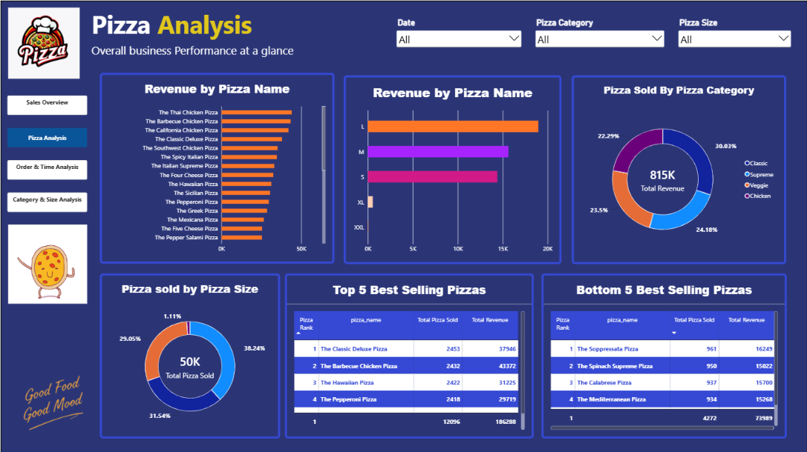
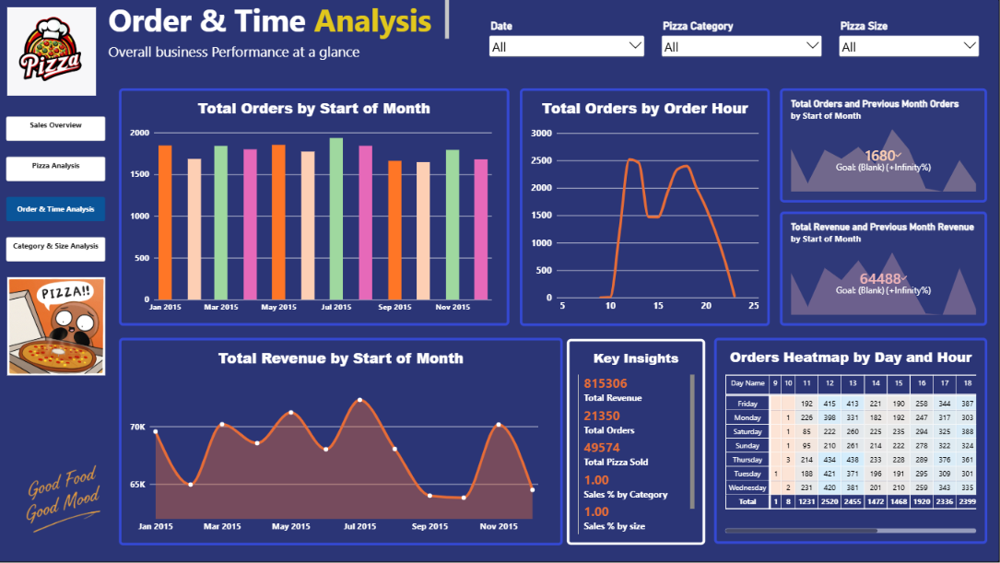
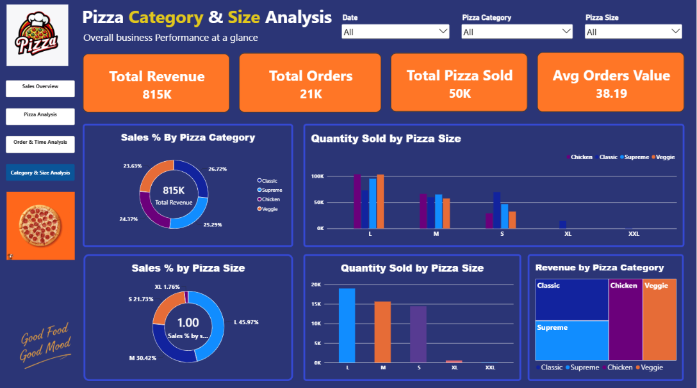

# 🍕 Pizza Sales Analysis Dashboard – Power BI

## 📌 Project Overview

The **Pizza Sales Analysis Dashboard** is an interactive Power BI project created to analyze pizza sales performance and understand customer ordering patterns.

The dashboard provides a complete view of business performance through four report pages. It focuses on revenue, orders, pizza sales, product performance, category-wise sales, and ordering trends.

The main objective of this project is to turn raw sales data into meaningful insights that can help a business understand its performance and make better decisions.

## 🎯 Project Objectives

- Monitor overall revenue, orders, and pizzas sold.
- Analyze monthly revenue and order trends.
- Identify the best-selling and lowest-selling pizzas.
- Compare sales performance across pizza categories and sizes.
- Understand customer ordering patterns by day and hour.
- Identify peak sales periods and the busiest day.
- Analyze revenue contribution by pizza category and size.

## 🛠️ Tools & Technologies

- **Power BI Desktop** – Dashboard development and visualization
- **Power Query** – Data cleaning and transformation
- **DAX** – Measures and calculations
- **Data Modeling** – Organizing data for analysis
- **Interactive Slicers** – Dynamic filtering by date, pizza category, and pizza size

## 📊 Dashboard Features

### 1. Sales Overview

- Total Revenue
- Total Orders
- Total Pizzas Sold
- Average Order Value
- Monthly Revenue Trend
- Revenue by Pizza Category
- Revenue by Pizza Size
- Peak Sales Time
- Peak Sales Day
- Top Category and Best-Selling Size

### 2. Pizza Analysis

- Revenue by Pizza Name
- Revenue by Pizza Size
- Pizza Sold by Pizza Category
- Pizza Sold by Pizza Size
- Top 5 Best-Selling Pizzas
- Bottom 5 Best-Selling Pizzas

### 3. Order & Time Analysis

- Total Orders by Start of Month
- Total Orders by Order Hour
- Total Revenue by Start of Month
- Orders Heatmap by Day and Hour
- Key Business Insights
- Previous Month Order and Revenue Comparisons

### 4. Category & Size Analysis

- Sales Percentage by Pizza Category
- Quantity Sold by Pizza Size and Category
- Sales Percentage by Pizza Size
- Quantity Sold by Pizza Size
- Revenue by Pizza Category

## 💡 Key Business Insights

Some key observations:

- **Friday** is the peak sales day.
- **12 PM – 5 PM** is the peak sales period.
- **Classic** is the top revenue-generating pizza category.
- **Large (L)** is the best-selling pizza size.
- Monthly revenue trends help identify changes in sales performance throughout the year.

*Note: These values may change when different slicers and filters are applied.*

## 🖼️ Dashboard Preview

### 1. Sales Overview



### 2. Pizza Analysis



### 3. Order & Time Analysis



### 4. Category & Size Analysis



## 🚀 How to Use

1. Clone or download this repository.
2. Open `Pizza_Sales_Dashboard.pbix` in Power BI Desktop.
3. Connect to the original pizza sales dataset if required.
4. Refresh the data if the source file is available.
5. Explore all four dashboard pages using the interactive filters and slicers.

**Note:** The original dataset is not included in this repository. Refreshing the report may require access to the original dataset and updating the data source path.

## 📁 Repository Structure

```text
Pizza-Sales-Analysis/
│
├── README.md
├── Pizza_Sales_Dashboard.pbix
│
└── Screenshots/
    ├── Sales_Overview.png
    ├── Pizza_Analysis.png
    ├── Order_Time_Analysis.png
    └── Category_Size_Analysis.png
```

## 📚 Skills Demonstrated

- Data Cleaning and Transformation
- Power Query
- Data Modeling
- DAX Measures
- KPI Development
- Time-Based Sales Analysis
- Product and Category Analysis
- Sales Performance Analysis
- Data Visualization
- Interactive Dashboard Design
- Business Intelligence

## 👩‍💻 Author

**Janavi Parmar**

Aspiring Data Engineer | Power BI | SQL | Python | Data Analytics

🔗 [Janavi Parmar – LinkedIn](https://www.linkedin.com/in/janavi-parmar-45a5b02b0/)

---

Thanks for visiting my project! Feel free to explore the dashboards and share your feedback.
